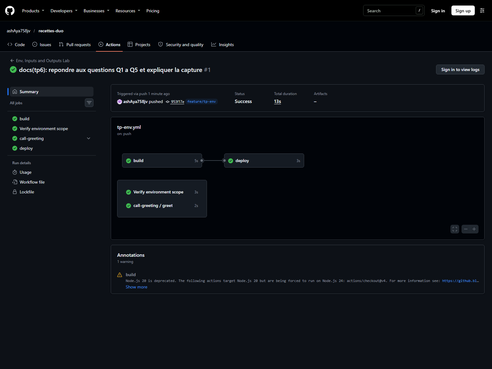

# TP6 — Variables d'environnement, inputs et outputs

Dépôt : `ashAya758jv/recettes-duo` — branche : `feature/tp-env`.

## Q1 — Pourquoi la variable n'est-elle disponible que dans les steps suivantes ?

Chaque step `run` démarre dans un nouveau processus. Écrire dans `$GITHUB_ENV`
ne modifie pas l'environnement du shell en cours : le runner lit ce fichier après
la step et injecte ses valeurs dans les steps suivantes du même job. Pour utiliser
aussi la valeur immédiatement, il faudrait définir une variable dans le shell
courant, en plus de l'écrire dans `$GITHUB_ENV`.

## Q2 — Que constate-t-on dans `verify-env` ? Quelle est la portée de `GITHUB_ENV` ?

La step `Print APP_NAME` du job `verify-env` affiche :

```text
APP_NAME in another job = ''
```

Ce job a son propre environnement et ne reçoit pas les valeurs écrites dans le
job `build`. La portée de `GITHUB_ENV` couvre uniquement les steps suivantes du
job qui l'a écrit. Ajouter une dépendance `needs` ne partage pas cet environnement.

## Q3 — Que se passe-t-il avec `>` au lieu de `>>` pour deux outputs ?

`>` vide le fichier avant chaque écriture ; `>>` ajoute à son contenu. Ainsi :

```bash
echo "first=one" > "$GITHUB_OUTPUT"
echo "second=two" > "$GITHUB_OUTPUT"
```

La seconde commande efface `first` : seul `second` reste disponible. Avec `>>`
pour les deux commandes, les deux outputs sont conservés. Une unique redirection
`>` appliquée à un groupe de commandes n'effacerait le fichier qu'une seule fois.

## Q4 — Pourquoi `GITHUB_ENV` ne suffit-il pas entre deux jobs ?

Les jobs sont isolés. `GITHUB_OUTPUT` définit d'abord une sortie de step ; il ne
partage pas directement toutes les variables entre les jobs. Le transfert exige
les trois liaisons suivantes :

1. La step `version` écrit `full_version` dans `$GITHUB_OUTPUT`.
2. `build.outputs.full_version` expose `steps.version.outputs.full_version`.
3. `deploy` déclare `needs: build` et lit `needs.build.outputs.full_version`.

Le résultat transmis est `<version>-<date>`, par exemple `1.0.0-2026-11-20`.

## Q5 — Que se passe-t-il sans `needs: build` dans `deploy` ?

`deploy` n'attend plus la fin de `build` et peut s'exécuter en parallèle. `build`
n'appartient plus à son contexte `needs` : sa sortie n'est donc plus accessible.
La propriété absente est évaluée comme une chaîne vide, et notre simple `echo`
afficherait `Deploying  to staging`. Un contrôle statique peut aussi signaler
cette référence à une dépendance non déclarée. `needs: build` assure à la fois
l'ordre d'exécution et l'accès à l'output ; si `build` échoue, `deploy` est ignoré
par défaut.

## Workflows livrés

- `.github/workflows/tp-env.yml` : variables, trois inputs, debug conditionnel,
  transfert de version entre `build` et `deploy`, vérification de portée et appel
  du workflow réutilisable.
- `.github/workflows/greeting.yml` : `workflow_call`, input `recipient` de type
  `string`, job `greet` et step `Print greeting` affichant `Bonjour staging` lorsque
  l'environnement choisi est `staging`.

Les noms des jobs et des steps sont en anglais. Les inputs sont transmis au shell
par des variables d'environnement pour éviter d'insérer leur contenu dans le code
des commandes. Aucun fichier du TP5 n'est modifié.

## Exécution et capture d'écran

### Valider la branche sans modifier `main`

Le workflow inclut un déclencheur `push`, limité à `feature/tp-env` et aux deux
fichiers de workflow. La publication initiale lance donc une exécution avec
`staging` et `1.0.0`. Les inputs manuels étant absents lors d'un push, ces deux
valeurs de repli sont utilisées et la step de debug est ignorée.

1. Ouvrir [Actions du dépôt](https://github.com/ashAya758jv/recettes-duo/actions).
2. Ouvrir l'exécution **Env, Inputs and Outputs Lab** de `feature/tp-env`.
3. Attendre le statut **Success** et les coches vertes des jobs `build` et `deploy`.
4. Dans `build`, vérifier `Print environment variables` puis `Compute full version`.
   Dans `deploy`, ouvrir `Show deployment target` : la version doit correspondre
   à celle calculée par `build`, avec la cible `staging`.
5. Revenir au résumé pour capturer le nom du dépôt, la branche et le graphe
   montrant `build` puis `deploy` réussis. Sous Windows : `Win` + `Maj` + `S`.
6. Enregistrer la capture sous `captures/tp6-actions-success.png`, puis l'ajouter
   à la branche si elle n'y figure pas déjà :

```bash
git switch feature/tp-env
git add captures/tp6-actions-success.png
git commit -m "docs(tp6): ajouter la capture des jobs build et deploy reussis"
git push
```

Pour répéter cette exécution depuis GitHub, utiliser **Re-run all jobs** sur
l'exécution existante en étant connecté avec les droits d'écriture.

### Lancement manuel avec les inputs demandés

GitHub impose que le workflow soit présent sur la branche par défaut pour activer
`workflow_dispatch`. Tant que `tp-env.yml` existe seulement sur `feature/tp-env`,
le bouton **Run workflow** peut être absent. Une commande CLI ou un appel API ne
remplace pas cette condition. Aucune fusion ni modification de `main` n'est faite
dans ce TP sans autorisation.

Une fois le workflow disponible sur la branche par défaut, après autorisation :

1. Ouvrir **Actions → Env, Inputs and Outputs Lab → Run workflow**.
2. Choisir la branche `feature/tp-env`, l'environnement `staging` et la version
   `1.0.0`.
3. Cocher `debug` pour voir la step `Print debug information`, puis lancer.
4. Vérifier les jobs et prendre la capture comme indiqué ci-dessus. Lors d'une
   autre exécution avec `debug` décoché, cette step doit être ignorée.

## Validation réalisée

- `actionlint v1.7.12` : les deux workflows sont valides.
- Exécution locale des scripts Bash : variables disponibles dans les steps
  suivantes, isolation de `verify-env`, transfert de la version, salutation et
  branchement debug vérifiés avec `false` puis `true`.
- [Exécution GitHub Actions réussie du 20 novembre 2026](https://github.com/ashAya758jv/recettes-duo/actions/runs/44764063223),
  déclenchée par le push du commit `953f17e` sur `feature/tp-env` : `build`,
  `verify-env`, `call-greeting / greet` et `deploy` réussis. La step debug est
  ignorée sur cette exécution automatique, comme prévu.
- Les six fichiers du TP5 sont identiques à ceux de `main`. La branche `main`
  est restée au commit `22705e9de37f922251275bc55b5594deb60a26f3` lors de la
  vérification distante ; aucune fusion n'a été effectuée.

Capture du résumé de cette exécution réelle :



## Références

- [Fichiers d'environnement et sorties de step](https://docs.github.com/en/actions/reference/workflows-and-actions/workflow-commands#environment-files)
- [Transmettre les outputs entre jobs](https://docs.github.com/en/actions/how-tos/write-workflows/choose-what-workflows-do/pass-job-outputs)
- [Contexte needs et propriétés absentes](https://docs.github.com/en/actions/reference/workflows-and-actions/contexts)
- [Lancer manuellement un workflow](https://docs.github.com/en/actions/how-tos/manage-workflow-runs/manually-run-a-workflow)
- [Réutiliser un workflow](https://docs.github.com/en/actions/how-tos/reuse-automations/reuse-workflows)
