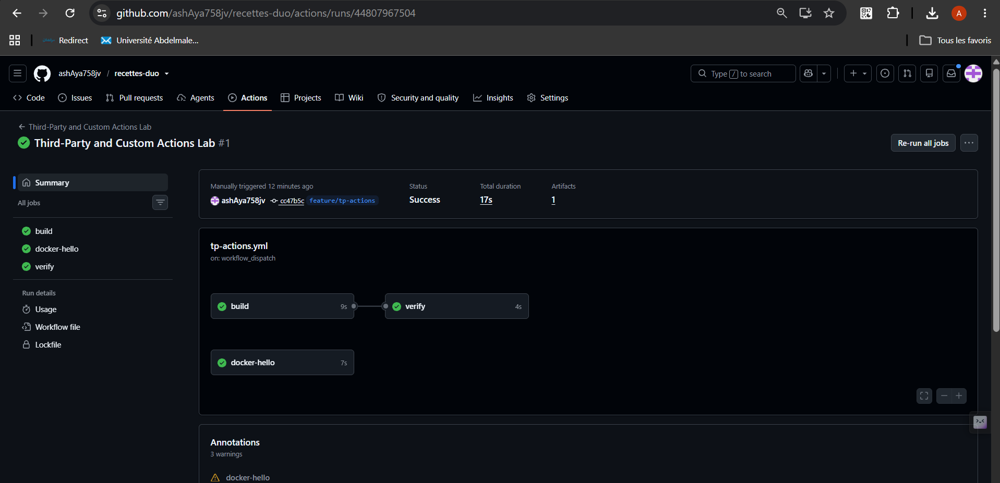
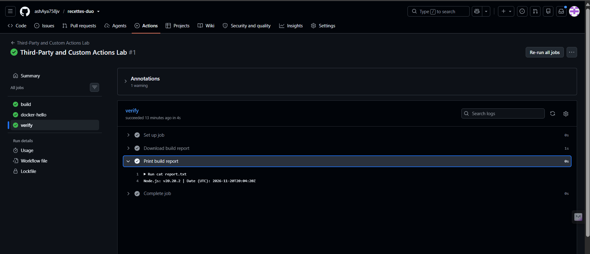

# Captures réelles du TP7

Ces deux captures ont été fournies par l'étudiante après
[l'exécution réussie du TP7](https://github.com/ashAya758jv/recettes-duo/actions/runs/44807967504)
sur `feature/tp-actions`.

| Fichier | Contenu visible |
| --- | --- |
| [tp7-actions-success.png](tp7-actions-success.png) | Statut Success, branche, trois jobs réussis et compteur Artifacts: 1 |
| [tp7-build-report.png](tp7-build-report.png) | Job verify réussi et contenu de report.txt dans Print build report |





Le fichier `report.txt` affiche :

```text
Node.js: v20.20.2 | Date (UTC): 2026-11-20T20:04:20Z
```

Le nom **build-report** apparaît dans la section **Artifacts** du résumé en
ligne, située plus bas que la zone visible dans la première capture. L'archive
a été réellement téléchargée et vérifiée. Pour la récupérer, ouvrir le
[résumé](https://github.com/ashAya758jv/recettes-duo/actions/runs/44807967504),
puis cliquer sur **build-report** dans **Artifacts** et décompresser `report.txt`.

Pour compléter la preuve visuelle demandée par l'énoncé, une capture de cette
section peut aussi être ajoutée afin de rendre le nom **build-report** lisible.
